# BRKTA Design System

> A cross-framework design system with shared tokens, accessible components, and a CLI for Angular and React apps.

[](LICENSE) [](https://github.com/ic0nk/brkta-design-system/releases) [](https://github.com/orgs/ic0nk/packages?repo_name=brkta-design-system) [](https://ic0nk.github.io/brkta-design-system/)

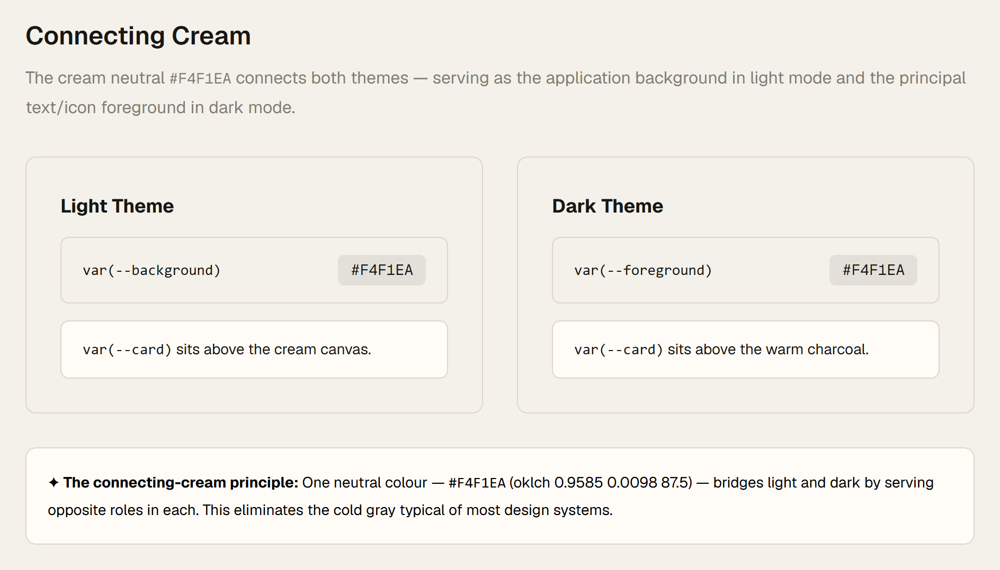

## Component gallery

<!-- gallery:start -->
<table>
  <tr>
    <td align="center"><br><strong>Foundations · themes</strong></td>
    <td align="center">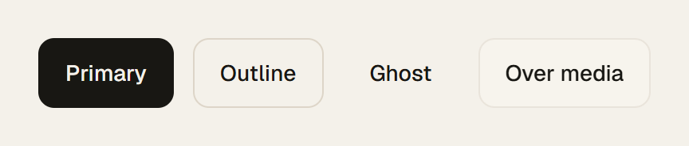<br><strong>Button · light</strong></td>
    <td align="center">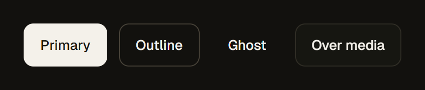<br><strong>Button · dark</strong></td>
  </tr>
  <tr>
    <td align="center">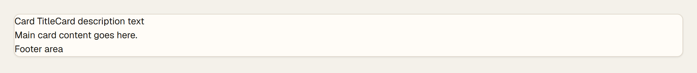<br><strong>Card · light</strong></td>
    <td align="center">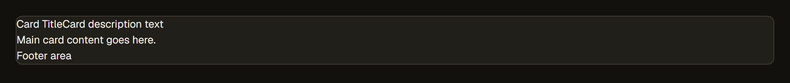<br><strong>Card · dark</strong></td>
    <td align="center">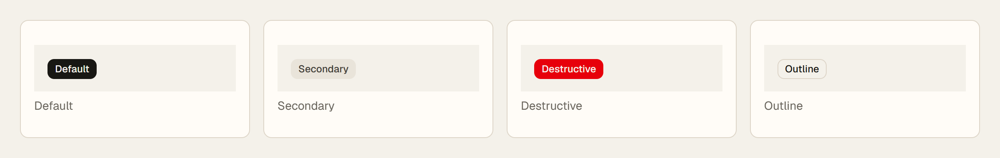<br><strong>Badge · light</strong></td>
  </tr>
  <tr>
    <td align="center">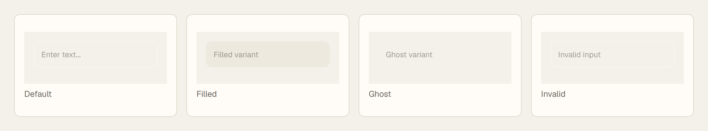<br><strong>Input · light</strong></td>
    <td align="center">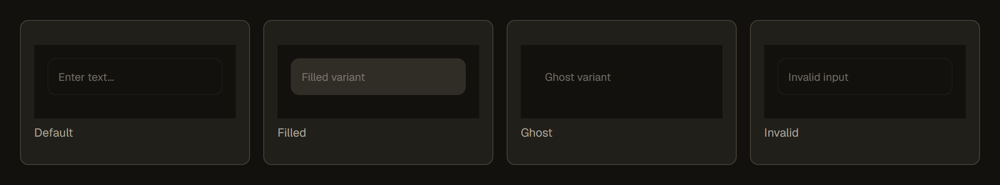<br><strong>Input · dark</strong></td>
    <td align="center">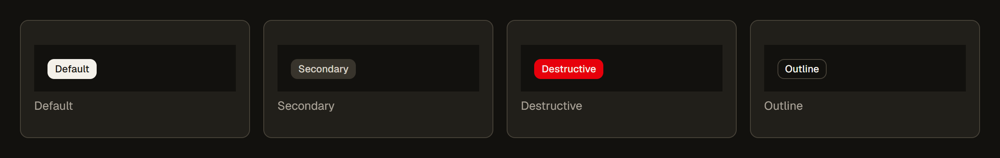<br><strong>Badge · dark</strong></td>
  </tr>
  <tr>
    <td align="center">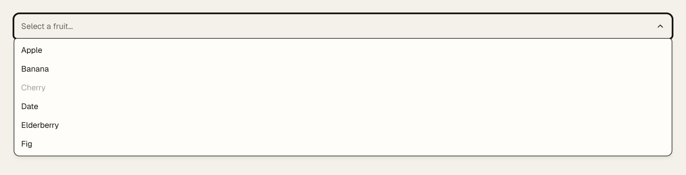<br><strong>Select</strong></td>
    <td align="center">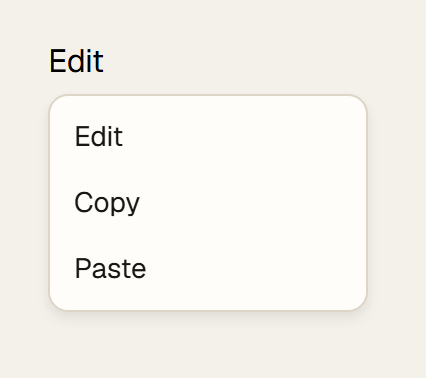<br><strong>Dropdown menu</strong></td>
    <td align="center">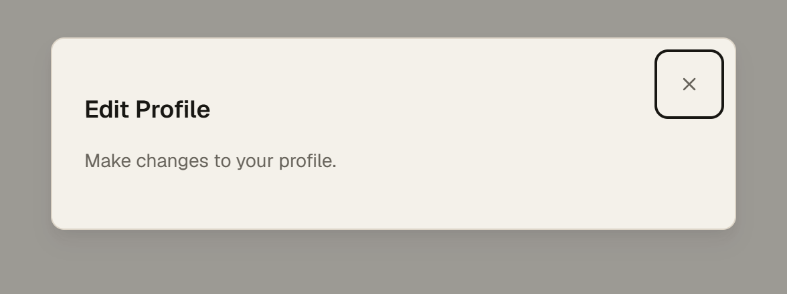<br><strong>Dialog</strong></td>
  </tr>
  <tr>
    <td align="center">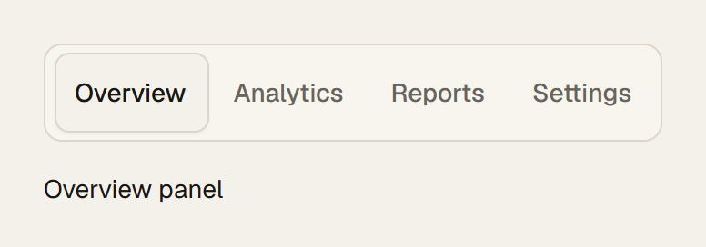<br><strong>Tabs</strong></td>
    <td align="center">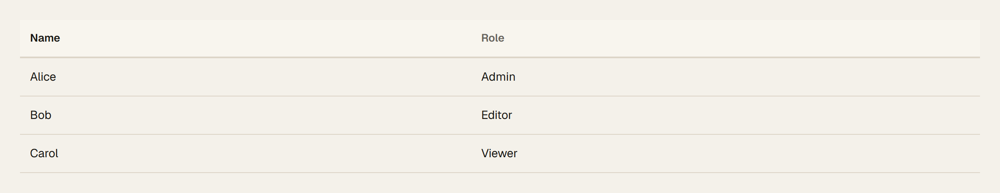<br><strong>Data table</strong></td>
    <td align="center">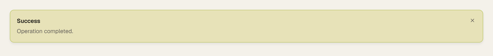<br><strong>Toast</strong></td>
  </tr>
  <tr>
    <td align="center">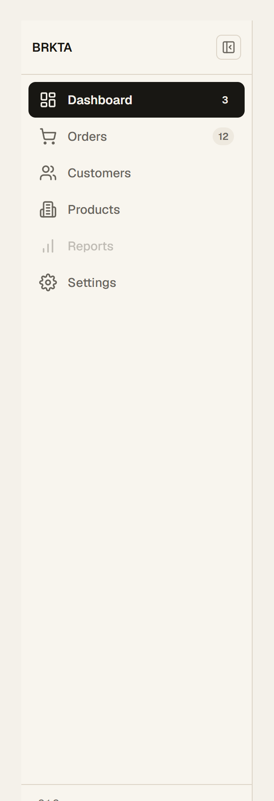<br><strong>Sidebar</strong></td>
    <td align="center">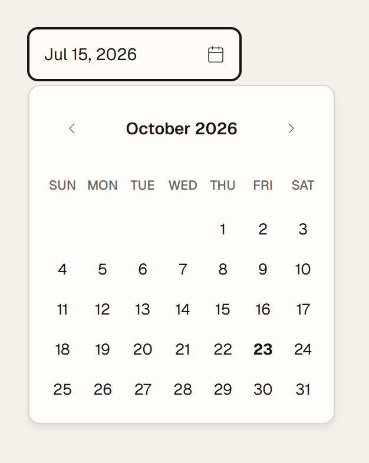<br><strong>Date picker</strong></td>
    <td align="center">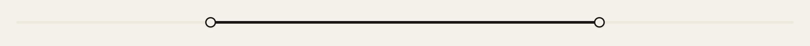<br><strong>Slider</strong></td>
  </tr>
  <tr>
    <td align="center">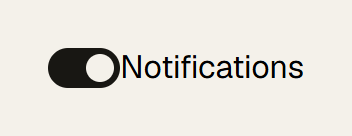<br><strong>Switch</strong></td>
    <td align="center">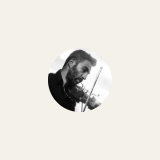<br><strong>Avatar</strong></td>
    <td></td>
  </tr>
</table>
<!-- gallery:end -->

## Features

- Angular and React components built from one shared contract and CSS layer.
- Semantic design tokens for color, typography, spacing, radius, elevation, and effects.
- Light and dark themes, right-to-left (RTL) layout support, and accessibility-minded defaults.
- Animated icon wrappers with reduced-motion support.
- CLI setup, component guidance, and package updates.

## Quick start

Packages are published to GitHub Packages. Create a GitHub token with `read:packages` permission. Configure the registry and authentication in your **user-level** npm configuration before using `pnpm dlx`; otherwise pnpm cannot download the CLI.

```sh
npm config set @brkta:registry https://npm.pkg.github.com
```

Add this line to your user-level `.npmrc` (for example, `~/.npmrc`), replacing the environment variable with your token or keeping it as an environment reference:

```ini
//npm.pkg.github.com/:_authToken=${GITHUB_TOKEN}
```

Set `GITHUB_TOKEN` in your shell or secret manager, and do not commit credentials. Then, from an Angular or React/Next.js project:

```sh
pnpm dlx @brkta/cli init
pnpm dlx @brkta/cli add button
```

The CLI detects Angular versus React/Next.js, installs only the matching framework package, and configures shared styles. See [Angular setup](docs/getting-started/angular.md), [Next.js setup](docs/getting-started/nextjs.md), and the [CLI reference](docs/cli.md).

## Use a component

### React / Next.js

```tsx
import { Button } from '@brkta/ui-react/button';

export function SaveAction() {
  return <Button variant="primary">Save</Button>;
}
```

### Angular

```ts
import { Component } from '@angular/core';
import { ButtonComponent } from '@brkta/ui-angular';

@Component({
  standalone: true,
  imports: [ButtonComponent],
  template: `<brkta-button variant="primary">Save</brkta-button>`,
})
export class SaveActionComponent {}
```

The CLI initializes token and shared component CSS imports. For manual CSS setup, see [theming](docs/theming.md).

## Packages

| Package | Purpose |
| --- | --- |
| [`@brkta/design-tokens`](packages/design-tokens/README.md) | CSS tokens, themes, fonts, and effects |
| [`@brkta/ui-core`](packages/ui-core/README.md) | Framework-neutral contracts and shared CSS recipes |
| [`@brkta/ui-react`](packages/ui-react/README.md) | React component wrappers |
| [`@brkta/ui-angular`](packages/ui-angular/README.md) | Angular component wrappers |
| [`@brkta/icons`](packages/icons/README.md) | Generic icon assets and governed BRKTA brand assets |
| [`@brkta/platform-core`](packages/platform-core/README.md) | Framework-neutral platform primitives |
| [`@brkta/cli`](packages/cli/README.md) | Project setup, component help, and update commands |

## Documentation and Storybook

- [Documentation site](https://ic0nk.github.io/brkta-design-system/)
- [Docs index](docs/README.md)
- [React Storybook](https://ic0nk.github.io/brkta-design-system/react/)
- [Angular Storybook](https://ic0nk.github.io/brkta-design-system/angular/)
- [Component registry](docs/component-registry.json)

## Updating

Run `pnpm dlx @brkta/cli update` in a consuming project to update its installed `@brkta/*` packages. Use `pnpm dlx @brkta/cli update --check` to check for outdated packages without updating them. See [CLI commands](docs/cli.md).

## Contributing

See [CONTRIBUTING.md](CONTRIBUTING.md) for setup, checks, changesets, and the component contribution checklist. Please also read the [Code of Conduct](CODE_OF_CONDUCT.md).

## License, trademarks, and third-party notices

The project code is MIT licensed; see [LICENSE](LICENSE). The BRKTA, BRKTA ONE, and ICONK logos and brand marks are not licensed for reuse. You may use them only to refer to BRKTA; see [TRADEMARKS.md](TRADEMARKS.md) and [`@brkta/icons` licensing](packages/icons/LICENSE).

### Third-party notices

- **Geist / Geist Pixel** font files: SIL Open Font License 1.1, Copyright 2024 The Geist Project Authors. See [`packages/design-tokens/fonts/OFL.txt`](packages/design-tokens/fonts/OFL.txt) and the [upstream Geist OFL](https://raw.githubusercontent.com/vercel/geist-font/main/OFL.txt).
- **Noto Sans Arabic** and other `@fontsource` Geist font packages: SIL Open Font License (OFL); their upstream copyright and license notices are included with their respective package distributions.
- **Lucide** icons (`lucide-react` and Lucide paths used by wrappers): ISC License; see [Lucide’s license](https://github.com/lucide-icons/lucide/blob/main/LICENSE).
- **GSAP**: distributed under its own license; see [GSAP licensing](https://gsap.com/licensing/).

The packages are published to GitHub Packages at `npm.pkg.github.com`; consumers need GitHub authentication with `read:packages` to install them.
